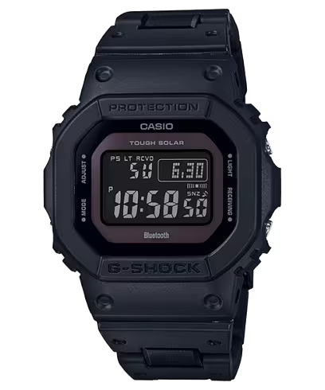
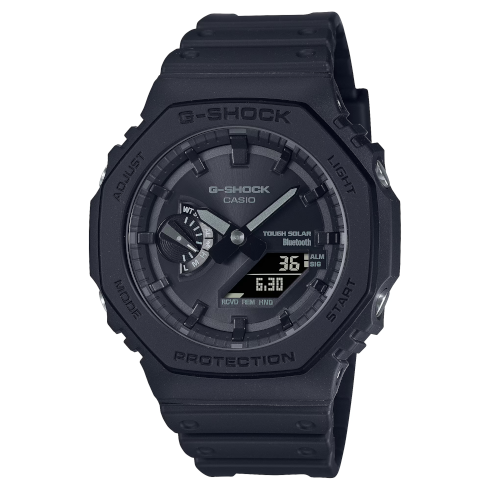
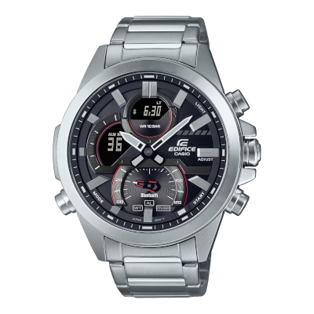
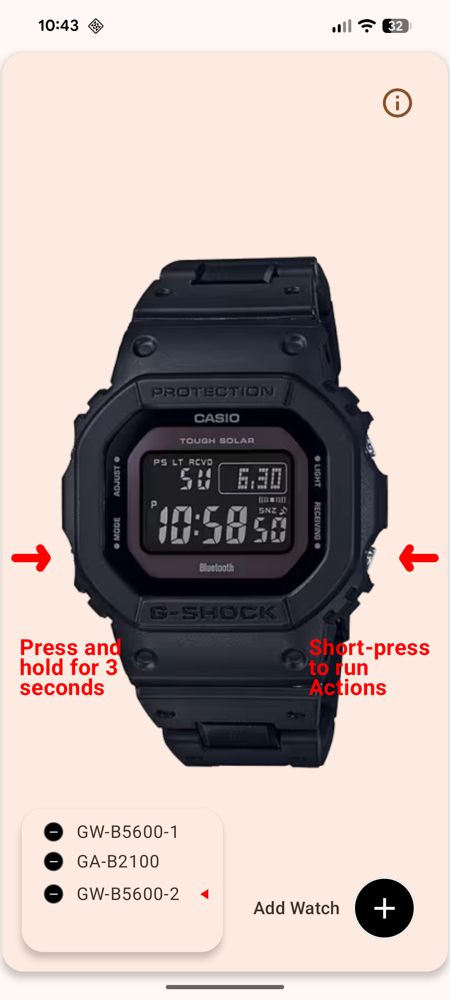
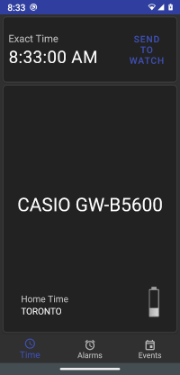
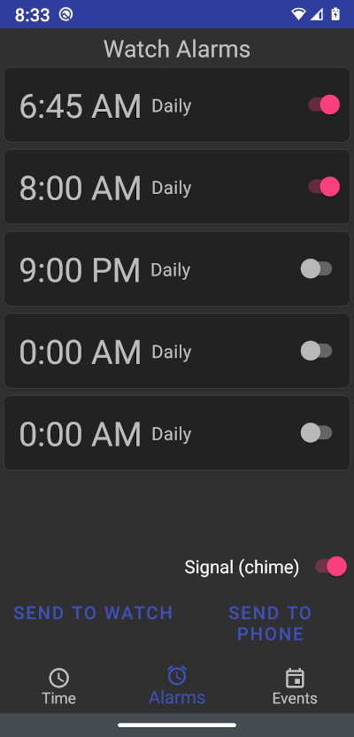
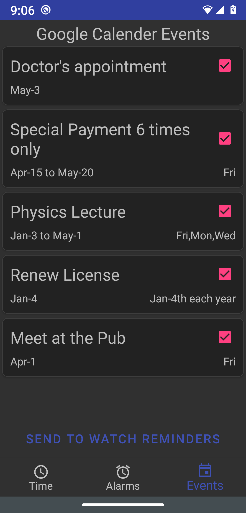
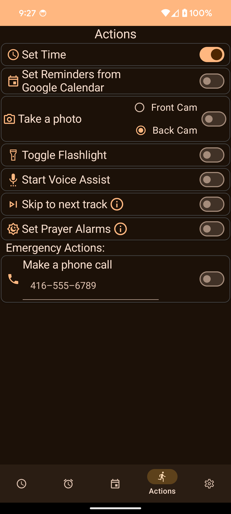
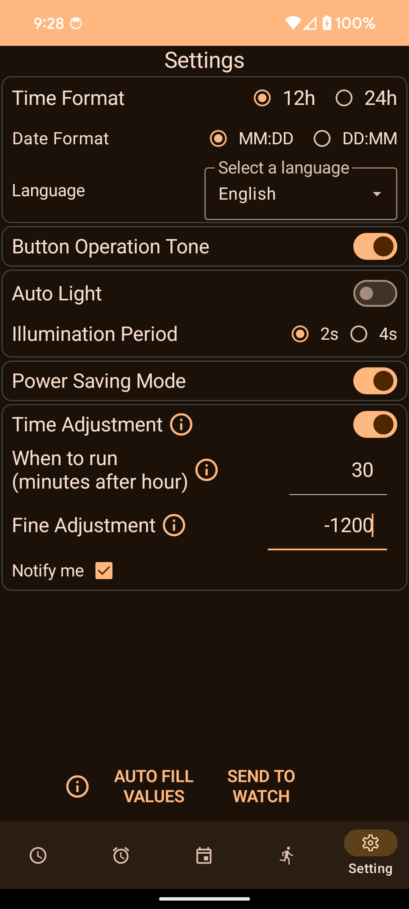

# Casio G-Shock Smart Sync

<p align="center">
  <a href="https://f-droid.org/en/packages/org.avmedia.gshockGoogleSync/"></a>
  <a href="https://play.google.com/store/apps/details?id=org.avmedia.gshockGoogleSync"></a>
  <a href="https://github.com/izivkov/CasioGShockSmartSync"></a>
  <a href="https://github.com/izivkov/CasioGShockSmartSync/releases"></a>
  <a href="#"></a>
</p>

**G-Shock Smart Sync** is an unofficial, open-source Android app for G-Shock, Edifice, and Pro Trek watches. It allows you to control your watch, sync data, and configure settings **without a Casio ID**.

It offers a faster, privacy-focused, and more powerful alternative to the official Casio app.

---

## What's New

### DW-H5600 (G-SQUAD): full support and a complete health picture

- **Health screen** with today's steps, energy, activity time, heart rate, blood oxygen, cardio load and breathing exercises.
- **History on your phone**: week and month charts of steps, heart rate and sleep, a detail view for each day, and CSV or JSON export.
- **Sleep** for each night: sleep score, Nightly Recharge status, time asleep, deep, light, REM and awake time.
- **Workouts** with laps and samples (heart rate, altitude, cadence, and GPS when the watch recorded it), also exportable.
- **Background health read** on a schedule you choose (5, 15, 30 or 60 minutes, or off) while the watch stays connected.
- **Watch settings** for the DW-H5600 family: watch face, health settings (units, heart rate measurement, bedtime, night window, step goal), activity list, notification sounds and tide data.

Details: [DW-H5600 Health Data](#dw-h5600-health-data).

### Plugins: connect the watch to your phone and your home

- **Home Assistant**, **Health Connect** and **TRMNL** ship with the app. Every plugin stays **off until you turn it on**.
- Each plugin states what it reads, what it may control and where it sends data. You see that before you turn it on, and the app keeps the plugin to it.
- The plugin interface is open, with more plugins (such as Tasker) in the plugin repository.

Details: [Plugins](#plugins) and [How plugins work](docs/plugin-architecture.md).

---

## Key Features

- **No Account Required**: Skip the Casio ID login entirely.
- **Voice Control**: Manage alarms, timers, settings, and reminders using natural language commands.
- **Calendar Sync**: Push your calendar events (Google, Samsung, etc.) to your watch as reminders.
- **Auto Timezone**: Automatically adjusts watch time when you travel.
- **Remote Control**: Use your watch buttons to take photos, control music, or launch voice assistants.
- **Alarm & Timer Sync**: Configure watch alarms and timers easily from your phone.
- **Phone Finder**: Trigger a loud alarm on your phone to find it.
- **Health & LifeLog Integration**: View step counts, energy expenditure, heart rate, and activity metrics for supported models (DW-H5600, GBD, ABL series). The DW-H5600 adds blood oxygen, sleep, history and workouts: see [DW-H5600 Health Data](#dw-h5600-health-data).
- **Plugins**: Connect the watch to Home Assistant, Android Health Connect, TRMNL and more. See [Plugins](#plugins).

---

## Supported Watch Models

The app works with many Bluetooth-enabled G-Shock, Edifice, Oceanus, and Pro Trek models.

<p align="center">
  
  
  
  
</p>

| Series | Compatible Models (Examples) | Note |
|:---|:---|:---|
| **Square** | GW-B5600, GMW-B5000, GW-B5000, DW-B5600, DW-H5600, TRN-50 | Classic & G-SQUAD square design support |
| **CasiOak** | GA-B2100, GBM-2100, GMC-B2100, MRG-B2100 | Octagonal bezel models |
| **G-Steel** | GST-B100 to B1000, GST-W1000, ECB-900 | Metal series |
| **Edifice** | ECB-10 to ECB-2300, EQB-500 to EQB-2000 | Bluetooth Edifice series |
| **MT-G / MR-G** | MTG-B1000/B3000/B3100, MRG-B5000/B2100 | Premium metal and carbon models |
| **Oceanus** | OCW-S400 | Manta S400 series |
| **Others** | ABL-100WE, GBD-100/200, GBD-H1000/H2000, GPR-B1000 | Step trackers, GPS, and sensors |

---

## DW-H5600 Health Data

The DW-H5600 (and the GBX-H5600 family) records steps, heart rate, blood oxygen, sleep and workouts on the watch. The app reads that record, the watch's **LifeLog**, over Bluetooth **without a Casio ID**, and keeps it on your phone.

### Today

The Health screen shows, from the latest read:

| Data | What you see |
|:---|:---|
| Steps and activity | Steps and the step goal, energy (an estimate) and the time walking, cycling and active |
| Heart rate | The day's highest and lowest, the resting rate, the most recent reading and the heart rate through the day |
| Blood oxygen | The latest reading and when it was taken |
| Cardio load | The load ratio and status, strain and tolerance |
| Breathing exercises | When the latest one was done and how many came with this read |
| Watch status | When the data was last read, and whether new data is waiting on the watch |

### History

Every read is stored in a database **on your phone**, so the history grows with each read.

- **Week and Month charts** for steps, heart rate (resting and highest) and sleep.
- **Tap a day** for its detail: steps per hour, distance, energy, active minutes, time walking, running and still, resting, lowest and highest heart rate, blood oxygen, and floors climbed and descended.
- **Sleep** for each night: sleep score, Nightly Recharge status, when you fell asleep and woke up, total, deep, light, REM and awake time, heart rate and breathing rate.
- **Export** the whole history as CSV or JSON from the share sheet. A gap in the data is an empty cell (CSV) or `null` (JSON), never a 0.

### Workouts

Workouts are read from the watch and stored with their laps and samples: heart rate, altitude, cadence and, when the watch recorded a route, GPS position. They can be exported as CSV or JSON.

Some workout values (distance, pace, speed and cadence) are not fully decoded yet. They are marked **unconfirmed** in the app and in the export, and should not be trusted as exact.

### Reading the data

- **From the Health screen**, when you open it.
- **In the background**, at the interval set in Settings under **Background health read**: 5, 15, 30 or 60 minutes, or **Off**. It only runs while the watch stays connected. The default is 15 minutes.
- **Through plugins** such as Home Assistant and Health Connect, which receive each read (see [Plugins](#plugins)).

### Watch settings for the DW-H5600 family

At the top of Settings:

- **Watch face**, and what the top-right place shows on the custom face.
- **Watch health settings**: length unit, heart rate measurement, bedtime and wake-up time, night window, step reminder and step goal.
- **Activity settings**: which activities the watch shows and in what order, and the settings of each.
- **Notifications**: sound and vibration mode, per-event switches, the sound pattern, language, and off at night.
- **Tide**: what the watch shows, three points of your own, and a port from open data.

### Privacy

Health data stays on your phone. It leaves only when you export it, or when you turn on a plugin that sends it, and the plugin tells you where. The technical background of the LifeLog frames is in [docs/sleep-research.md](docs/sleep-research.md).

---

## Plugins

Plugins connect Smart Sync to other apps and services, so the watch's data and controls can be used outside the app. The plugin system is built to keep your data under your control:

- **Off until you turn them on.** Plugins ship with the app but do nothing until you switch one on in **Settings > Plugins**.
- **They say what they do.** Before you turn a plugin on you see what it reads (steps, heart rate, sleep, ...), what it may control on the watch, and where it sends data.
- **The app keeps them to it.** What a plugin did not declare, it does not get.
- **Your phone, your choice.** You can turn a plugin off at any time and delete the data it stored.

### Plugins in this version

The plugins are developed in [**smartsync-plugins**](https://github.com/ExcuseMi/smartsync-plugins), a separate project that also holds the plugin interface.

| Plugin | What it does |
|:---|:---|
| [**Home Assistant**](https://github.com/ExcuseMi/smartsync-plugins/tree/main/plugins/homeassistant) | The watch in Home Assistant through MQTT: battery, steps, heart rate, sleep and workouts as sensors; the watch face, auto light, heart rate mode, alarms and bedtime as controls; notifications to the watch; the watch button as a trigger; and history in Home Assistant's long-term statistics. The same MQTT topics work with openHAB, Node-RED and ioBroker. |
| [**Health Connect**](https://github.com/ExcuseMi/smartsync-plugins/tree/main/plugins/healthconnect) | Writes steps, heart rate, resting heart rate, oxygen saturation, sleep sessions and exercise sessions to Android Health Connect, so apps such as Google Fit can show them. It only writes and never reads Health Connect. |
| [**TRMNL**](https://github.com/ExcuseMi/smartsync-plugins/tree/main/plugins/trmnl) | Sends the watch's values to a TRMNL e-ink display through a private plugin webhook, within TRMNL's rate limits. |
| [**Tasker**](https://github.com/ExcuseMi/smartsync-plugins/tree/main/plugins/tasker) | Watch events and states for Tasker, MacroDroid and Automate profiles, and watch actions for their tasks. In the plugin repository; not part of this build. |

### Using a plugin

1. Open **Settings > Plugins**.
2. Tap a plugin to read what it does, what it needs and what it reads, controls and sends.
3. Switch it on. The app asks for any Android permission it needs, and the plugin may open its own settings screen.
4. The plugin's card shows its status. Switch it off, or delete its data, from the same place.

### Writing your own plugin

A plugin is an Android library that implements one interface. The plugin repository has the interface, the rules and four working examples. How the app loads, limits and serves plugins is described in [**How plugins work**](docs/plugin-architecture.md).

---

## App Walkthrough

Here is a guide to the main screens of the application.

### 1. Connection Screen



This is the first screen you see. It handles the Bluetooth connection to your watch.

- **Status**: Shows generic connection status.
- **Scan/Connect**: Automatically scans for your watch.
- **Paired Devices**: Lists your previously connected watches for quick access.

The app communicates directly with the watch via BLE. Connection is typically much faster than the official app (~3.5s vs 12s).

<br clear="all"/>

### 2. Time Setting & Voice Control



Manage your watch's timekeeping and control features via voice.

- **Voice Control**: Tap the microphone icon on the watch name card to issue voice commands. 
    - Say *"Help"* for a full list of supported commands.
    - Examples: *"Set alarm at 7:30 am"*, *"Set timer for 5 minutes"*, *"Disable all alarms"*, *"Reset settings"*.
- **Local Time**: Displays the current time from your phone.
- **Send to Watch**: Tap the button to sync your phone's time, timezone, and DST settings to the watch immediately.
- **Battery & Temp**: Displays the current battery level and temperature reported by the watch.

<br clear="all"/>

### 3. Alarms



Read and configure the alarms stored on your watch.

- **View Alarms**: See the current settings for all 5 alarms and the hourly signal (Chime).
- **Edit**: Tap any alarm to change its time.
- **Sync**: You can send these alarm settings to the watch. 

*Note: Due to Android limitations, we cannot read alarms set in your phone's native Clock app, but we can set the watch's internal alarms.*

<br clear="all"/>

### 4. Events (Calendar & Reminders)



Sync your Android calendars to your watch!

- **Upcoming Events**: Lists future events from your phone's calendars.
- **Send to Watch**: Pushes these events to the watch's Reminder feature.
- **Manual Mode**: Switch to manual mode to create reminders directly in the app that won't be overwritten by your phone calendar.
- **Transliteration**: Automatically converts Cyrillic and other unsupported characters to Latin for watch compatibility.

<br clear="all"/>

### 5. Actions (Remote Control)



Turn your watch into a remote control. Assign actions to button presses on the watch.

- **Available Actions**:
  - **Find Phone**: Make your phone ring loudly.
  - **Take Photo**: Snap a picture with your phone's camera.
  - **Flashlight**: Turn on your phone's flashlight.
  - **Media Control**: Play/Pause and Next Track for music.
  - **Voice Assist**: Launch Google Assistant.
  - **Set Prayer Alarms**: Set the watch's 5 alarms to Islamic Prayer Times.
- **How to use**: Short-press the lower-right button on the watch (when in Time mode) to trigger the selected action.

<br clear="all"/>

### 6. Settings



Configure app and watch preferences.

- **Watch Settings**: Adjust light duration, power saving, date format, language, and more.
- **App Settings**: Configure theme, connection behavior, and notifications.
- **Smart Defaults**: Easily reset all settings to optimal defaults based on your phone's locale and watch model.

<br clear="all"/>

---

## Privacy

G-Shock Smart Sync is built with privacy in mind. We do not require an account, and we do not collect your personal data.
- **No Account Required**: Use all features without a Casio ID.
- **Local Processing**: All data stays on your device.
- **Open Source**: The code is transparent and auditable.

Read our full [Privacy Policy](https://izivkov.github.io/CasioGShockSmartSync/) for more details.

---

## Installation

- **F-Droid**: [Download here](https://f-droid.org/en/packages/org.avmedia.gshockGoogleSync/)
- **GitHub**: [Download APK from Releases](https://github.com/izivkov/CasioGShockSmartSync/releases/)
- **Google PlayStore**: [Download here](https://play.google.com/store/apps/details?id=org.avmedia.gshockGoogleSync) (Un-branded version)

## Contributing

We welcome contributions!
- **Code**: Submit a PR to add features or fix bugs.
- **Watches**: If you have a G-Shock model not yet supported, functionality can often be added. Donations of test units are also highly appreciated to help expand compatibility.

## Related Projects

| Project                                                                              | Description |
|:-------------------------------------------------------------------------------------|:---|
| [**GShockAPI**](https://github.com/izivkov/GShockAPI)                                | The core Android library that **this app is built on**. It encapsulates all low-level Bluetooth communication and watch protocol logic into a clean Kotlin API. |
| [**smartsync-plugins**](https://github.com/ExcuseMi/smartsync-plugins)               | The plugin interface and the plugins for this app: Home Assistant, Health Connect, TRMNL and Tasker. |
| [**G-Shock Time Server**](https://github.com/izivkov/GShockTimeServer)               | A Python script that acts as a headless time server for Raspberry Pi or other always-on Linux devices. |
| [**G-Shock API for ESP32**](https://github.com/izivkov/gshock-api-esp32)             | Standalone G-Shock time server for ESP32 microcontrollers — no phone or PC required. |
| [**G-Shock Smart Sync Webapp**](https://github.com/izivkov/gshock-smart-sync-webapp) | Experimental web-based app for watch synchronization from a browser via Web Bluetooth. |
| [**gshock_api**](https://github.com/izivkov/gshock_api)                              | A **Python API library** for G-Shock watches, featuring a pure functional architecture. |
| [**TRRRST Watch**](https://github.com/taxmeifyoucan/trrrst-watch)                      | An alternative FOSS android companion app for the new Casio F-B100W |

---

## For Developers

### Capturing BLE Messages with Wireshark

Wireshark can be used to inspect the raw Bluetooth Low Energy (BLE) packets exchanged between your Android phone and the G-Shock watch. This is useful for reverse-engineering watch protocols or debugging communication issues.

#### 1. Phone Setup (Enable HCI Snoop Log)

Android has a built-in BLE packet logger. Enable it via Developer Options:

1. Go to **Settings → About Phone** and tap **Build Number** 7 times to enable Developer Options.
2. Go to **Settings → Developer Options**.
3. Enable **Bluetooth HCI Snoop Log** (exact label varies by device/Android version).
4. **Restart Bluetooth** (toggle it off and on) to start logging.
5. Reproduce the action you want to capture (e.g., connect the app to the watch and sync time).
6. Disable the snoop log again, then pull the log file from the device:

```bash
adb bugreport bugreport.zip
```

The HCI log is embedded in the bugreport. Alternatively, on many devices it is available directly at `/sdcard/btsnoop_hci.log`.

#### 2. Install Wireshark

```bash
# Ubuntu / Debian
sudo apt install wireshark

# macOS (Homebrew)
brew install --cask wireshark
```

Or download the installer from [wireshark.org](https://www.wireshark.org/download.html).

#### 3. Open and Filter the Log

1. Open Wireshark and go to **File → Open**, then select `btsnoop_hci.log`.
2. Wireshark will decode the BLE packets automatically.
3. Use display filters to focus on relevant traffic:

| Goal | Filter |
|:---|:---|
| All BLE ATT traffic | `btatt` |
| Specific device by address | `bluetooth.addr == AA:BB:CC:DD:EE:FF` |
| ATT write operations | `btatt.opcode == 0x12` |
| ATT notifications | `btatt.opcode == 0x1b` |

4. Right-click a packet → **Follow → Bluetooth ATT Stream** to trace a full conversation.

---

## Credits

### ExcuseMi

[**ExcuseMi**](https://github.com/ExcuseMi/CasioGShockSmartSync) contributed a large pull request to this project with:

- **full support for the DW-H5600**, including the health data described above,
- **many improvements to the user interface**, and
- **the plugin system**, which lets the app load plugins.

ExcuseMi also created the plugins that make use of it, in [**smartsync-plugins**](https://github.com/ExcuseMi/smartsync-plugins): Home Assistant, Health Connect, TRMNL and Tasker. Thank you!

### gatman45

[**gatman45**](https://github.com/gatman45/gshock) wrote a detailed report, with the evidence behind it, on how the DW-H5600 sends its LifeLog over Bluetooth GATT: [rapport_detaille_preuves_lifelog_gatt.md](https://github.com/gatman45/gshock/blob/main/rapport_detaille_preuves_lifelog_gatt.md). Its detailed data helped in understanding and decoding the DW-H5600's health data. Thank you!

---

## License

This project is licensed under the MIT License - see the LICENSE file for details.

The Home Assistant icon is from Material Design Icons (Pictogrammers), Apache-2.0.

The bundled tide constants (Tide screen) come from TICON-4: Hart-Davis M., Dettmering D., Seitz F. (2025), TIdal CONstants based on GESLA-4 sea-level records, SEANOE, https://doi.org/10.17882/109129, licensed CC BY 4.0 (https://creativecommons.org/licenses/by/4.0/). The values were rounded and reformatted for the watch.
