# Technical Overview

This is the starting map for understanding how Casio G-Shock Smart Sync works. The diagram comes first; the sections below explain the main paths through it and point to the deeper docs.

## Component Map

The diagram shows the major app blocks and how they connect. `ProgressEvents` carries events between components; the storage block distinguishes phone preferences from data stored in the watch scratchpad. `GShockAPI` owns the BLE link and watch protocol.

## The Main Idea

The app has two kinds of work:

- **Watch and phone operations.** `ActionContainer` owns reusable actions such as setting alarms, sending reminders, changing watch settings, and controlling phone features. Different triggers can invoke the same action, so each feature's orchestration is not duplicated across screens, voice, and watch buttons.
- **State and coordination.** `ProgressEvents` announces important events such as connection changes and completed writes. Long-lived handlers and screen ViewModels subscribe to the events they need. ViewModels expose screen state to Compose, while `MainEventHandler` handles app-level connection and navigation decisions.

The app is built to respond even when no screen is visible. `GShockApplication` wires up process-scoped handlers, `ActionRunner`, and the shared action container; these are not created by a Composable. Android background services and watch events can therefore reconnect or trigger work independently of the UI.

## Four Common Paths

### 1. A watch button triggers an action

1. The watch communicates through `GShockAPI`, which emits a button-information event on `ProgressEvents`.
2. The process-scoped `ActionRunner` interprets the event using `GShockRepository` and asks `ActionContainer` to run the eligible action or actions.
3. An action may operate on the phone, the watch, or both. Watch reads and writes go through `GShockRepository` to `GShockAPI`.
4. When useful, the action publishes a result event such as `AlarmsUpdated`; a subscribed ViewModel refreshes its state.

`ActionContainer` checks each action's `RunEnvironment` policy. A watch-button trigger does not automatically run every action.

### 2. A voice command changes the watch

1. The Time screen starts `VoiceCommandManager`, which uses Android speech recognition to produce text.
2. `IntentParser` turns the text into a typed `VoiceCommand`.
3. `VoiceDispatcher` consults `voiceCommandTable`, checks support and enabled state, fills in the shared action's parameters, and asks `ActionContainer` to run it.
4. The action performs the operation and may publish a feature event. `VoiceDispatcher` provides spoken success or error feedback.

Voice is another entry point into the Actions system, not a separate watch-writing implementation. Reminders use a multi-turn voice conversation to collect their details before invoking the reminder action. The current dispatcher does **not** automatically navigate to the screen named in a voice command's route metadata.

### 3. A user edits a feature screen

1. A screen's ViewModel loads watch state and exposes it to Compose, usually through a `StateFlow`.
2. A simple read or operation can go through `GShockRepository`; operations shared with other triggers go through the corresponding `ActionContainer` action.
3. After a write, an action can publish an update event. The ViewModel handles that event and refreshes screen state from the watch, rather than assuming the requested values were applied.

This is why the same alarm-writing behavior can be used by the Alarms screen and a voice command while each entry point keeps its own input handling.

### 4. A paired watch reconnects in the background

Android's Bluetooth scan, companion-device presence callbacks, or adapter state changes can indicate that a watch is available. The pairing/presence components coordinate the connection through `GShockRepository`; the connection and initialization events then reach app-level handlers through `ProgressEvents`. The process-scoped design lets this work begin without first opening an Activity.

## Responsibilities and Code Landmarks

| Component | Responsibility | Main location |
|---|---|---|
| `GShockAPI` | BLE connection, pairing, GATT, and Casio watch protocol | External JitPack dependency, declared in `app/build.gradle` |
| `GShockRepository` | Injectable app-facing wrapper delegating to `GShockAPI` | `data/repository/GShockRepository.kt` |
| `ProgressEvents` | Shared event bus used by the library and app | Defined by `GShockAPI`; app subscriptions use `utils/ProgressEventsExt.kt` where applicable |
| `MainEventHandler` | App-level reactions to connection, error, and notification events | `MainEventHandler.kt` |
| `ActionRunner` | Maps watch events to action triggers | `ui/actions/ActionRunner.kt` |
| `ActionContainer` | Process-scoped action registry, eligibility, persistence, and operation workflows | `ActionContainer.kt` |
| `Voice` | Speech recognition, parsing, command routing, and feedback | `voice/` |
| Feature ViewModels | Load and expose feature state; respond to relevant events | `ui/alarms/`, `ui/events/`, `ui/settings/`, `ui/time/` |
| Pairing and Android services | Background device presence, notifications, boot handling, and related integration | `pairing/`, `services/`, `receivers/` |
| Local storage | Small app-side settings and state such as action configuration and alarm labels | `scratchpad/` |

## Events: Useful Details

`ProgressEvents` is a process-wide, string-keyed publish/subscribe bus. A producer publishes a named event and optional payload; subscribers register handlers for names they care about. Examples include `WatchInitializationCompleted`, `Disconnect`, `ButtonPressedInfoReceived`, `AlarmsUpdated`, `EventsUpdated`, and `SettingsUpdated`.

Use `subscribeToProgressEvents()` for subscriptions owned by recreatable ViewModels or Composables. It gives each registration a unique name and returns that name for cleanup. The underlying library silently ignores duplicate subscription names, so a fixed name can leave a recreated screen listening through an old instance instead of its current one. Process-scoped subscribers that are created once have different lifecycle needs.

An event announces a fact or result; it does not replace the underlying operation. For example, an action writes alarms through the repository, then may publish `AlarmsUpdated`. The alarm screen independently receives that event and refreshes its view of the watch.

## Lifetime and State

- `GShockApplication.onCreate()` registers `MainEventHandler` and `ActionRunner` subscriptions at process startup.
- `ActionContainer` is a singleton because actions can be requested while the app has no visible screen. `ActionsViewModel` is a screen-scoped facade for the Actions UI; it is not the owner of the shared actions.
- `MainActivity` and the Compose navigation host present screens. Feature ViewModels own screen state and should not be confused with the process-scoped event/action layer.
- App-side preferences and small persisted values live in `scratchpad/`. This is distinct from watch storage and from the Bluetooth protocol managed by `GShockAPI`.

## Where to Read Next

- [Actions](ACTIONS.md) explains action ownership, trigger policies, and the alarm workflow.
- [UI Screen Management](UI_SCREEN_MANAGEMENT.md) explains how watch capabilities control which UI features are shown.
- [Scratchpad Buffer Layout](SCRATCHPAD_LAYOUT.md) documents the fixed-offset scratchpad clients and their persisted values.
- [Voice and Actions Subsystem](voice-actions-subsystem.md) walks through the voice-to-action flow and its event feedback. Some class-ownership names in that document predate the move to `ActionContainer`; use [Actions](ACTIONS.md) and current source for ownership details.
- [Voice Command Feature Spec](voice-command-feature-spec.md) contains additional voice-command design and test details. Its described `NavigateTo` flow is older than the current implementation: voice route metadata remains, but `VoiceDispatcher` does not currently publish a navigation event.

For BLE connection or protocol behavior, inspect the separate `GShockAPI` project. This app repository contains the user-facing behavior and the orchestration around that library, not the underlying GATT implementation.
